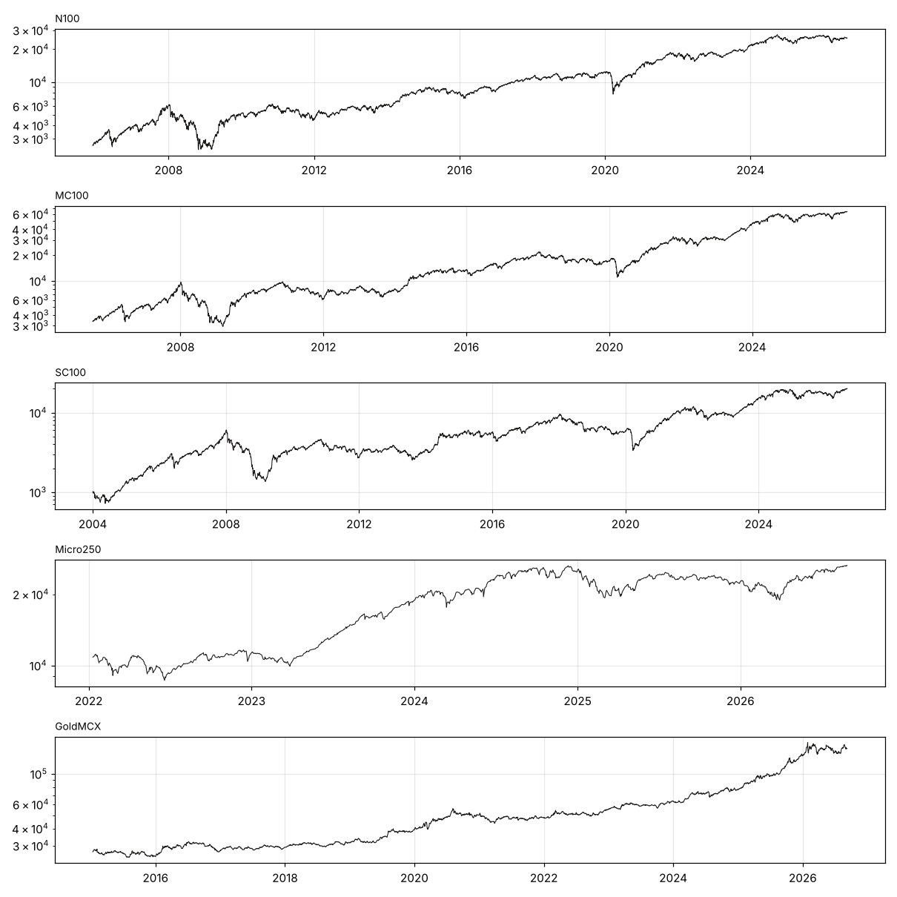

# Data review (Step 0)

Reviewed 2026-11-12. Every file the tests read is listed here with its fingerprint; the approved list is `APPROVED_DATA.md`. Problems carry IDs `F-RA-D##`.

## index_ohlcv_all.csv

- **What:** daily OHLC of the NSE indices (price indices, points; volume blank for most)
- **Job:** signal, fill price (OHLC4), valuation
- **Source:** the desk's index file (NSE data via the research data store), copied from the wm-BREAK repo on 2026-11-12; fetched there on 2026-11-02
- **Adjustment / meaning of the price:** index levels: price return (no dividends); no corporate actions apply
- **Fingerprint:** sha256 `3499a3b9c942c95ecbd711540d7fb0d92246992dff27ae30864295592b6a2efa`, 3,619,661 bytes

- Rows: 33,616; index keys in the file: microcap250, midcap100, midcap150, nifty100, nifty50, nifty500_synth, smallcap100, smallcap250.
- Used by the tests: nifty100 → N100, midcap100 → MC100, smallcap100 → SC100, microcap250 → Micro250. The other keys (nifty50, midcap150, smallcap250, nifty500_synth) are not read — nifty500_synth is a synthetic blend and is never read as a result.

| series | rows | first | last | dup | weekend | gaps > 5d | blank close | OHLC order errors | flat runs | jumps > 8% |
|---|---|---|---|---|---|---|---|---|---|---|
| N100 | 5,128 | 2005-11-30 | 2026-08-28 | 0 | 8 | 1 | 0 | 1 | 0 | 6 |
|  | jumps: 2008-01-21 -9.7%; 2008-10-24 -12.6%; 2009-05-18 +15.9%; 2020-03-12 -8.7%; 2020-03-23 -13.7%; 2020-04-07 +8.1% |||||||||| 
|  | gaps over 5 days start after: 2014-10-07 |||||||||| 
| MC100 | 5,220 | 2005-07-18 | 2026-08-28 | 0 | 8 | 1 | 0 | 1 | 0 | 8 |
|  | jumps: 2006-06-08 -8.5%; 2008-01-21 -12.7%; 2008-10-24 -8.5%; 2009-05-18 +11.5%; 2015-08-24 -9.2%; 2020-03-12 -8.4%; 2020-03-23 -14.1%; 2024-06-04 -8.2% |||||||||| 
|  | gaps over 5 days start after: 2014-10-07 |||||||||| 
| SC100 | 5,606 | 2004-01-01 | 2026-08-28 | 0 | 8 | 1 | 0 | 6 | 0 | 12 |
|  | jumps: 2004-05-14 -8.2%; 2004-05-17 -11.8%; 2006-06-08 -9.3%; 2008-01-21 -12.9%; 2008-01-22 -9.3%; 2008-10-10 -9.4%; 2008-10-24 -9.9%; 2009-05-18 +8.9%; 2015-08-24 -11.2%; 2020-03-12 -10.0%; 2020-03-23 -14.1%; 2024-06-04 -8.6% |||||||||| 
|  | gaps over 5 days start after: 2014-10-07 |||||||||| 
| Micro250 | 1,146 | 2022-01-10 | 2026-08-28 | 0 | 2 | 0 | 0 | 0 | 0 | 0 |

## MAUc1_daily.csv

- **What:** daily OHLCV of the MCX gold front-month futures continuation (MAUc1), rupees per 10 g
- **Job:** signal, fill price (OHLC4), valuation of the gold leg
- **Source:** Refinitiv Eikon get_timeseries on MAUc1, copied from the wm-BREAK repo on 2026-11-12; fetched there on 2026-11-02
- **Adjustment / meaning of the price:** front-month continuation: roll yield is inside the return; no dividends
- **Fingerprint:** sha256 `29dd9d3756ad48d61b3c00cc5e40e76ddadae7516f625c535083e1f28c8e3227`, 121,658 bytes

| series | rows | first | last | dup | weekend | gaps > 5d | blank close | OHLC order errors | flat runs | jumps > 8% |
|---|---|---|---|---|---|---|---|---|---|---|
| GoldMCX | 3,000 | 2015-01-12 | 2026-09-08 | 0 | 8 | 0 | 3 | 1 | 0 | 1 |
|  | jumps: 2026-01-30 -12.4% |||||||||| 

## What the flagged rows are, and how the loader handles them

- **Weekend rows (8 per index, 8 in gold):** real sessions — Muhurat trading on Diwali (2006-04-29*, 2009-10-17, 2013-11-03, 2016-10-30, 2019-10-27, 2020-11-14, 2023-11-12), Budget-day Saturdays (2015-02-28, 2020-02-01, 2025-02-01) and Sunday 2026-02-01, and the NSE special live sessions of 2024-01-20 and 2024-05-18. Kept as trading days. (*2006-04-29 was a special Saturday session.)
- **OHLC order errors:** N100 2009-05-18 (close 4087.3 above high 4078.25 — the election-day session that was halted limit-up; the printed high stops at the halt), SC100 2015-08-20 and gold 2023-10-16 (a point or two of rounding). **Handled in the loader (rule H2 in `analysis/approved_data.py`):** high := max(high, open, close), low := min(low, open, close).
- **SC100 2011-04-01 … 04-07:** open = high = low = 3584.17 on five consecutive days while the close moves 3650 → 3874 — the OHL fields are a stale print. **Handled in the loader (rule H1):** on a row whose open, high and low are all equal and differ from the close, the fill price is the close instead of OHLC4 (the engine counts such rows in audit.json).
- **Gold blank closes (2015-10-02, 2015-11-11, 2020-04-14):** dropped; those days are absent from gold's calendar and therefore from every gold pair's calendar. Three further gold rows have a close but a blank open / high / low (2021-10-04, 2025-01-02, 2026-02-04): **handled in the loader (rule H3):** the fill price is the close; counted with the stale rows.
- **Gold 2026-01-30 −12.4%:** the day after an intraday range of 157,808–180,779 (14%); volume falls from ~13,000 lots to 619, 528 and 103 over the next three sessions, which is the front-month contract going into expiry while the continuation still points at it. A real spike plus a roll at thin volume. **Open item F-RA-D-OPEN-2:** the data owner should confirm against the MCX bhavcopy and, if the continuation is mis-rolled, re-fetch with a rolled series. Affects the four gold pairs only, which are reported, not deciding.

## Calendar and cross-checks

- The index series share the NSE calendar (no weekend rows; the gaps over 5 days are exchange holidays bridging a weekend). Gold trades on the MCX calendar, which differs from the NSE on some holidays; a pair's calendar in the tests is the intersection of its two legs' trading days, so no price is ever carried forward.
- Micro250 starts on 2022-01-10 (NSE back-computed history); every pair with Micro250 starts there, so its tests cover about four and a half years.
- The index file ends 2026-08-28 and gold 2026-09-08; a pair's window ends at the earlier of its two legs.
- Two sources of the same thing: only one source per series is available in this repo; no comparison made.
- Spot checks against a public source (NSE site / factsheets, MCX bhavcopy): **not done in this environment** (no network). Listed as an open item F-RA-D-OPEN-1 below; three dates per series should be checked by the data owner before any number from this repo is acted on.

## Verdicts

| file | verdict | why |
|---|---|---|
| index_ohlcv_all.csv | PASS WITH NOTES | price indices (no dividends); Micro250 short history; spot checks pending |
| MAUc1_daily.csv | PASS WITH NOTES | futures continuation (roll yield inside the return); MCX calendar differs from NSE; spot checks pending |

## Problems found

| id | series | what |
|---|---|---|
| F-RA-D01 | N100 | 8 weekend rows |
| F-RA-D02 | N100 | 1 close above high |
| F-RA-D03 | MC100 | 8 weekend rows |
| F-RA-D04 | MC100 | 1 close above high |
| F-RA-D05 | SC100 | 8 weekend rows |
| F-RA-D06 | SC100 | 1 low above close |
| F-RA-D07 | SC100 | 5 close above high |
| F-RA-D08 | Micro250 | 2 weekend rows |
| F-RA-D09 | GoldMCX | 8 weekend rows |
| F-RA-D10 | GoldMCX | 3 blank closes |
| F-RA-D11 | GoldMCX | 1 close above high |
| F-RA-D-OPEN-1 | all | three dates per series not yet checked against a public source (no network here) |
| F-RA-D-OPEN-2 | GoldMCX | the 2026-01-30 fall and the thin-volume sessions that follow: confirm the continuation's roll against the MCX bhavcopy |

## Charts

